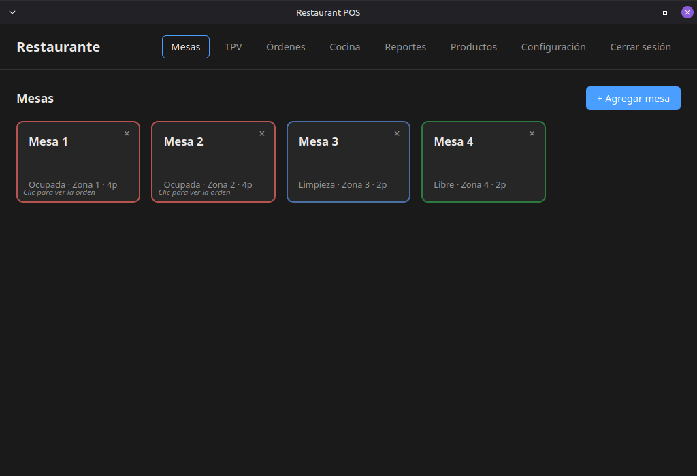
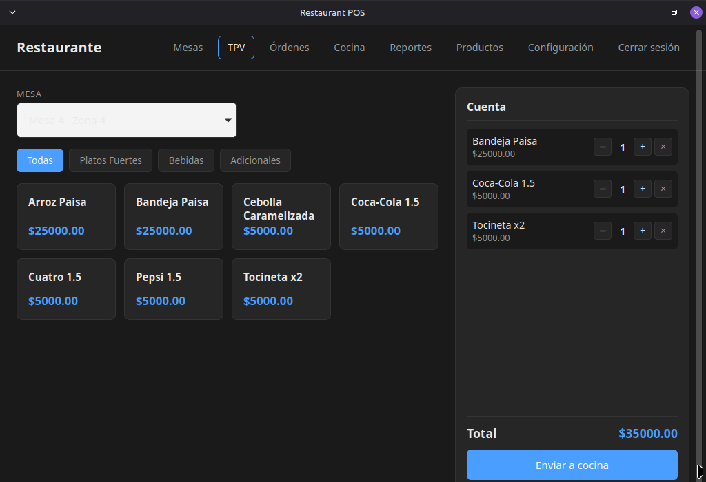
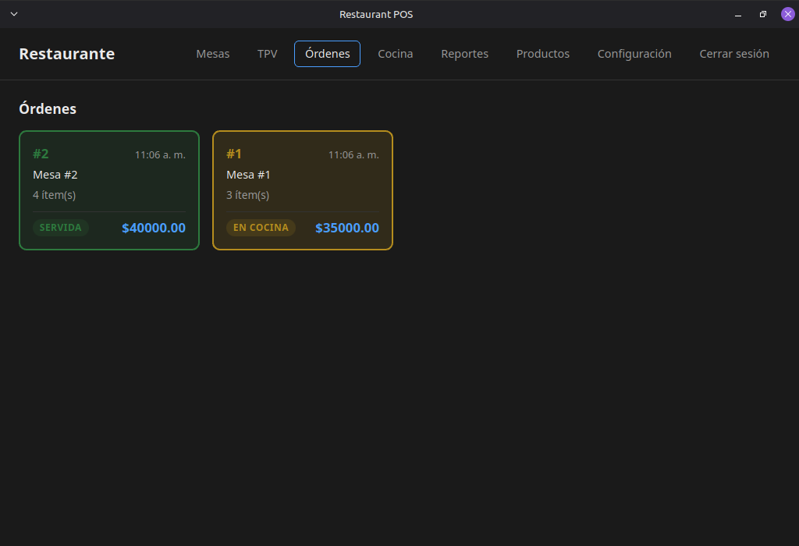
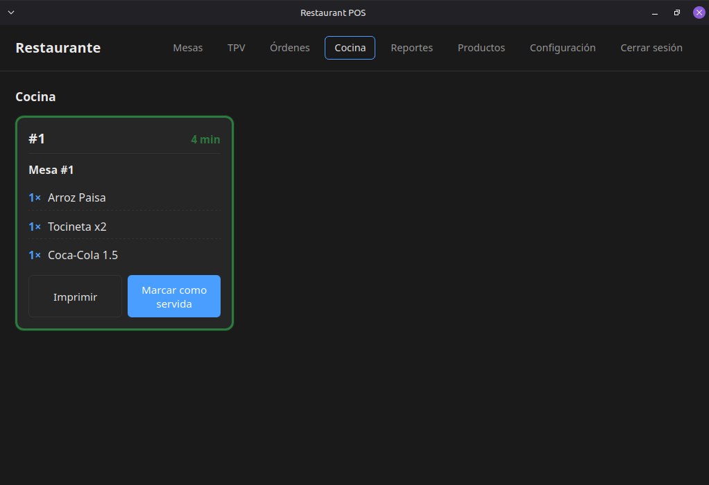
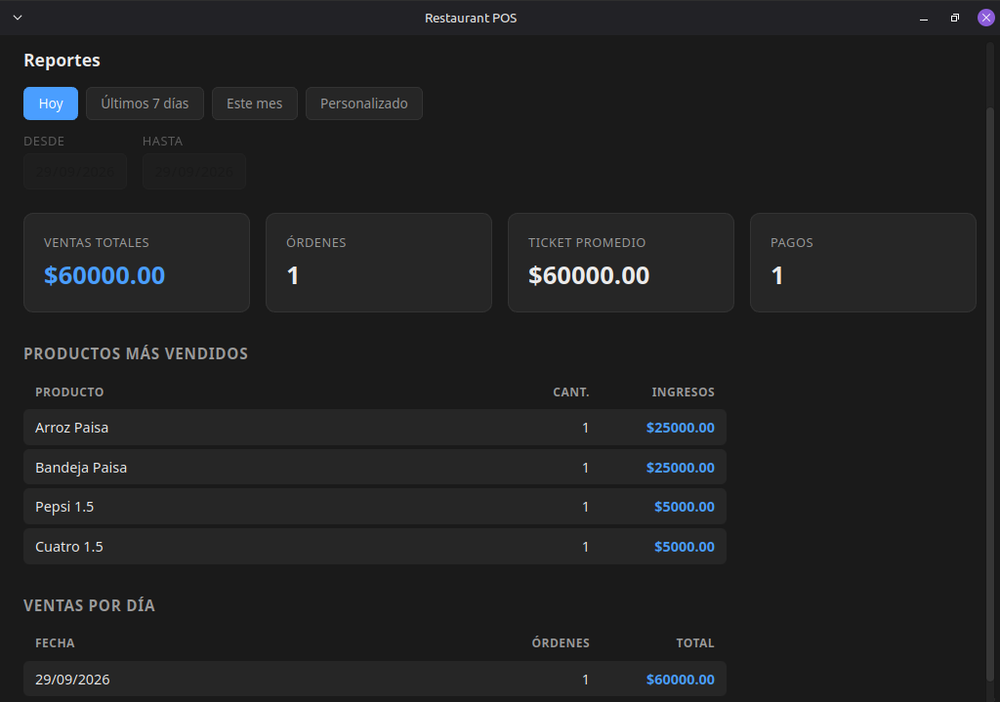
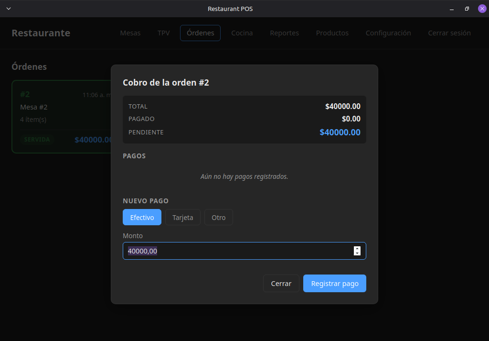

# MesaLista

A native, offline-first point of sale for restaurants, built with Rust and Tauri.
Fast, lightweight, multilingual, and fully self-contained: all data stays on
your machine.



---

## Table of contents

- [Features](#features)
- [Why MesaLista](#why-restaurant-pos)
- [Screenshots](#screenshots)
- [Tech stack](#tech-stack)
- [Installation](#installation)
- [Usage](#usage)
- [Documentation](#documentation)
- [Development](#development)
- [License](#license)
- [Contact](#contact)

---

## Features

### Core operation
- **Table management** — visual grid with live status (free, occupied, reserved, cleaning).
- **Point of sale** — touch-friendly product grid, cart, and one-tap send-to-kitchen.
- **Order tracking** — open orders, kitchen tickets, status transitions.
- **Kitchen Display System (KDS)** — real-time kitchen view with elapsed-time color coding.
- **Payments** — cash, card, or mixed; partial payments and change calculation.
- **Sales reports** — daily, weekly, monthly, and custom ranges with top-products ranking.

### Operations
- **Multi-user with roles** — admin, waiter, kitchen. PIN-based login.
- **Multi-language** — English and Spanish, switchable at runtime.
- **PDF printing** — sales receipts and kitchen tickets generated locally.
- **Automated backups** — daily backups, manual backups, one-click restore.
- **Restaurant profile** — name, address, phone, and footer message on receipts.

### Technical
- **100% offline** — no internet, no cloud, no external servers.
- **Native performance** — Rust backend, ~30 MB memory footprint.
- **Local SQLite database** — WAL mode, embedded, migrations.
- **Cross-platform potential** — Linux today; Windows and macOS easily buildable.

---

## Why MesaLista

Most restaurant software today is:

- **Cloud-based** → breaks when internet fails.
- **Subscription-based** → endless monthly fees.
- **Heavy** → built on Electron, consumes 500 MB+ of RAM.
- **Closed** → your data lives on someone else's server.

**MesaLista** is the opposite:

- Runs entirely on your machine.
- One-time license, no monthly fees.
- Lightweight enough for a 10-year-old PC.
- Your data is yours.

---

## Screenshots

| Tables | POS |
|---|---|
|  |  |

| Orders | Kitchen |
|---|---|
|  |  |

| Products | Reports |
|---|---|
|  |  |

| Payments | Settings |
|---|---|
|  |  |

---

## Tech stack

| Layer | Technology |
|---|---|
| Backend / core | Rust |
| Desktop framework | Tauri v2 |
| Frontend | HTML5, CSS3, JavaScript (ES modules) |
| Database | SQLite (embedded via `rusqlite`) |
| PDF generation | `printpdf` |
| Package manager | pnpm |

---

## Installation

### Ubuntu / Debian / Mint / Pop!_OS

Download the latest `.deb` from the [Releases page](../../releases) and run:

```bash
sudo dpkg -i "MesaLista_x.y.z_amd64.deb"
sudo apt install -f    # only if dependencies are missing
```

Then open **MesaLista** from your applications menu.

### Any Linux distribution (universal)

Download the `.AppImage`, make it executable, and run:

```bash
chmod +x "MesaLista_x.y.z_amd64.AppImage"
./"MesaLista_x.y.z_amd64.AppImage"
```

See [docs/install.md](docs/install.md) for details.

---

## Usage

On first launch, the app starts in **free mode** (no login required).

1. Go to **Products** and create categories and products.
2. Go to **Tables** and create the tables of your restaurant.
3. Open **Settings** to configure:
   - Restaurant name, address, phone, and receipt footer.
   - Receipt folder location.
   - Language.
4. Optional: create users in **Settings → Users** (roles: admin, waiter, kitchen).
5. Start selling from the **POS** view.

Full guide: [docs/user-manual.en.md](docs/user-manual.en.md) · [docs/user-manual.es.md](docs/user-manual.es.md).

---

## Documentation

### For users
- [User manual (English)](docs/user-manual.en.md)
- [Manual de usuario (Español)](docs/user-manual.es.md)
- [Installation guide](docs/install.md)

### For developers
- [Architecture](docs/architecture.md)
- [Database schema](docs/database-schema.md)
- [IPC contract (frontend ↔ backend)](docs/ipc-contract.md)

### For buyers
- [Sales one-pager](docs/sales-one-pager.md)
- [Changelog](CHANGELOG.md)
- [License](LICENSE)

---

## Development

### Requirements

- Rust (stable)
- Node.js (LTS)
- pnpm
- Tauri system dependencies (webkit2gtk, build tools)

### Setup

```bash
git clone git@github.com:joh4ndev-art/restaurant-app.git
cd restaurant-app
pnpm install
pnpm tauri dev
```

### Build

```bash
./release.sh
```

Or directly:

```bash
pnpm tauri build
```

Artifacts are placed in `src-tauri/target/release/bundle/`.

---

## License

Proprietary. See [LICENSE](LICENSE) for details.

---

## Contact

**Author:** Johan
**Email:** joh4ndev@gmail.com
**GitHub:** [@joh4ndev-art](https://github.com/joh4ndev-art)